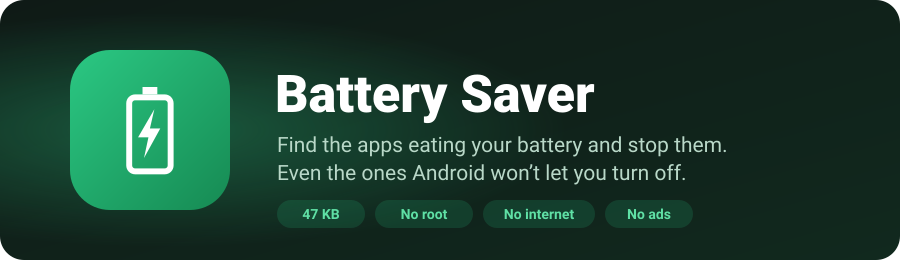

<p align="center">
  
</p>

<p align="center">
  <a href="https://github.com/abdullah-al-faahim/battery-saver-app/releases/latest/download/BatterySaver.apk">
    
  </a>
</p>

<p align="center">
  <a href="https://github.com/abdullah-al-faahim/battery-saver-app/releases/latest"></a>
  <a href="https://github.com/abdullah-al-faahim/battery-saver-app/releases"></a>
  
  
</p>

---

## Why Battery Saver?

Some apps keep running after you close them. Facebook, Messenger, TikTok and WhatsApp are common examples. They sync, track and wake your phone all day, and many of them **lock the switch** that would normally stop them.

Battery Saver shows you which apps are behind the drain and lets you put them to sleep with one tap.

| | |
|---|---|
| 🔋 **Battery drain ranking** | Every app ranked **High / Medium / Low** by screen time and background activity over the last 24 hours. |
| 🌙 **Background tab** | Apps that kept running services or skipped Android's battery optimization while you weren't using them. |
| 💬 **Social tab** | Facebook, Messenger, Instagram, WhatsApp, TikTok, Snapchat, X, Telegram, imo, Likee, YouTube and 30+ more, in one place. |
| ✋ **Manual turn-off** | Tick the apps → **Stop selected**. Battery Saver force-stops them all, including apps whose background switch is locked. |
| ⚡ **Quick Settings tile** | Pull down the notification shade → **Stop apps**. No need to open the app. |
| 🛠️ **Deep restrict** | For power users: ready-made ADB commands that block locked apps from running in the background at system level. |
| 🌡️ **Battery card** | Battery %, temperature, voltage, live current draw (mA), health and time to full charge. |

## Light by design

- **47 KB** install, smaller than a single photo.
- **Uses no battery itself.** No background service, no notifications, no scheduled jobs. It only works while it's open or when you press Stop.
- **Private.** The app has **no internet permission**, so nothing leaves your phone. No ads, no trackers, no account.
- **Safe.** Core system apps (Google Play services, phone, launcher, keyboard, Settings) are protected and can't be stopped by mistake.

## Install

1. Tap the **Download APK** button above on your phone.
2. Open the downloaded `BatterySaver.apk`. If asked, allow your browser to **install unknown apps**.
3. Open **Battery Saver** and tap **Allow** on the yellow banner → turn on **Usage access**. This lets the app see which apps are draining.
4. Tap **Turn on** for **1-tap stop** → *Installed apps* → **Battery Saver 1-tap stop** → On.

> **Android 13 or newer says "Restricted setting"?**
> Go to **Settings → Apps → Battery Saver → ⋮ (top right) → Allow restricted settings**, then repeat step 4.
> Android does this for every app installed outside the Play Store.

## How to use

1. Open the **Battery drain** or **Social** tab.
2. Tick the apps you want asleep.
3. Tap **Stop selected**. Keep the screen on for a few seconds while it works.

Stopped apps stay asleep until **you** open them again. Your list is saved, so after you've used an app, run Stop again (or tap the Quick Settings tile).

<details>
<summary><b>Optional: permanently block background running (Deep restrict)</b></summary>

<br>

For apps that restart themselves, Android's own background block can be switched on from a computer once:

1. On the phone, enable **Developer options → USB debugging**.
2. Connect it to a PC with [Android platform-tools](https://developer.android.com/tools/releases/platform-tools) installed.
3. In Battery Saver tap **Deep restrict**, then **Copy**, and run the commands on the PC. For example:

```
adb shell cmd appops set com.facebook.katana RUN_ANY_IN_BACKGROUND ignore
adb shell am set-standby-bucket com.facebook.katana restricted
```

This lasts through reboots. The same dialog shows the commands to undo it.
⚠️ Messaging apps blocked this way may deliver notifications late.

</details>

## FAQ

<details>
<summary><b>Why does it need Accessibility?</b></summary>
<br>
Android doesn't let normal apps close other apps. With 1-tap stop on, Battery Saver opens each app's page in Settings and presses <b>Force stop → OK</b> for you, the same thing you'd do by hand. It only works inside the Settings app, only after you press Stop, and reads nothing else. If you don't want this, choose <b>Do it manually</b>: Battery Saver opens each page and you tap Force stop yourself.
</details>

<details>
<summary><b>Are the battery numbers exact?</b></summary>
<br>
They're estimates. Android only gives exact per-app battery percentages to the phone maker's own system apps. Battery Saver uses screen time and background-service time, the two biggest causes of drain, to rank apps. You can always compare with <i>Settings → Battery</i>.
</details>

<details>
<summary><b>Will I still get WhatsApp / Messenger messages?</b></summary>
<br>
Not while the app is stopped. Notifications come back as soon as you open it. Leave apps you need instant messages from off your stop list.
</details>

<details>
<summary><b>Does it need root?</b></summary>
<br>
No. It works on any Android 8.0+ phone (Samsung, Xiaomi, Realme, Oppo, Vivo, Pixel, Motorola, …) without root.
</details>

<details>
<summary><b>Is this download safe?</b></summary>
<br>
Every release is signed with the same developer key. You can check the APK before installing:

- **Signing certificate SHA-256:** `64:1D:B1:3A:50:68:91:65:F4:49:08:18:B9:0B:40:F9:8B:04:72:80:A3:9B:A6:EB:C0:59:5E:96:41:4B:D1:CB`
- File checksums for each version are listed in its [release notes](https://github.com/abdullah-al-faahim/battery-saver-app/releases).
</details>

## Updates

New versions appear on the [Releases](https://github.com/abdullah-al-faahim/battery-saver-app/releases) page. Click **Watch → Custom → Releases** to be notified. The download button above always gets the newest version, and it installs over the old one without losing your stop list.

---

<p align="center">
  Made by <a href="https://github.com/abdullah-al-faahim">Abdullah Al Fahim</a> · Found a bug? <a href="https://github.com/abdullah-al-faahim/battery-saver-app/issues">Open an issue</a>
</p>
